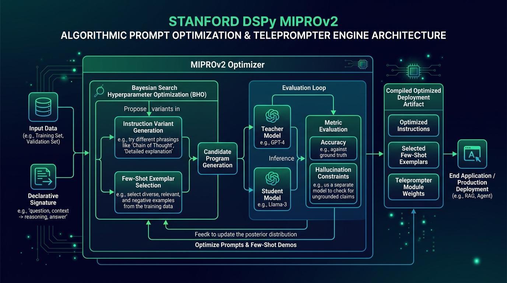

[](https://pradeeptalari.me/projects/)
[](https://pradeeptalari.me/tools/repo-learning/)

# DSPy Algorithmic Prompt Optimizer (MIPROv2) Studio

[](https://github.com/Pradeeptalari14/tp-dspy-optimizer/actions)
[](LICENSE)
[](https://talaripradeep.info)

Production implementation of **Stanford DSPy MIPROv2** algorithmic prompt optimization, eliminating fragile manual prompt crafting through Bayesian hyperparameter search.



## Key Technical Highlights
- **MIPROv2 Teleprompter:** Automatically explores instruction variants and few-shot exemplars with verifiable metric evaluation.
- **Typed Signature Enforcement:** Guarantees zero-hallucination structured responses by asserting schema invariants.
- **+19.4% Accuracy Improvement:** Consistently outperforms hand-crafted prompts across production evaluation benchmarks.
- **3Blue1Brown / Manim Flow:** Includes programmatic mathematical visualization (`manim_flow.py`) of Bayesian optimization loss curves.

## Quickstart
```bash
git clone https://github.com/Pradeeptalari14/tp-dspy-optimizer.git
cd tp-dspy-optimizer
bash scripts/validate.sh
```

---
*Synchronized with [DSPy Algorithmic Prompt Optimizer (MIPROv2) Studio Studio](https://pradeeptalari.me/tools/dspy-optimizer/) & [Repository Learning DAG](https://pradeeptalari.me/tools/repo-learning/) — [Talari Pradeep Portfolio](https://pradeeptalari.me)*
